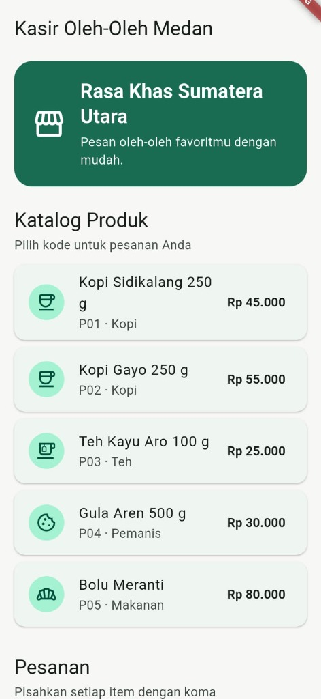
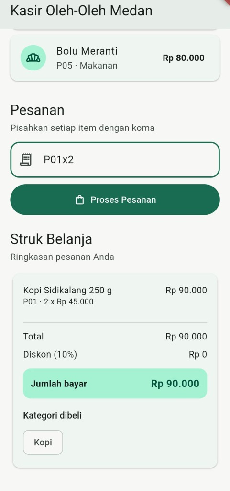

# Aplikasi Console Kasir Sederhana

## Identitas

- Nama: **[Isi nama Anda]**
- NIM: **[Isi NIM Anda]**
- Mata kuliah: Pemrograman Mobile

## Menjalankan program

Program console sesuai spesifikasi modul dapat dijalankan dari root proyek:

```shell
dart run bin/kasir.dart
```

Tampilan Flutter kasir juga tersedia. Jalankan aplikasi dengan:

```shell
flutter run
```

Di aplikasi, masukkan pesanan pada kolom Pesanan dan tekan **Proses Pesanan**.
Katalog dan struk ditampilkan langsung di layar.

Masukkan pesanan dalam satu baris, pisahkan item dengan koma. Contoh:
`P01x2, P03x1`. Kode produk tidak dikenal, format yang salah, dan jumlah
yang bukan bilangan bulat positif akan ditampilkan sebagai item yang ditolak.
Diskon 10% diberikan jika total belanja mencapai Rp100.000.

## Tangkapan layar

Berikut adalah tangkapan layar antarmuka aplikasi kasir:

1. **Katalog Produk & Form Pesanan**:
   

2. **Proses Pesanan & Struk Belanja (`P01x2`)**:
   

## Penjelasan konsep (100–200 kata)

Di `bin/kasir.dart`, `final` dipakai untuk nilai yang ditetapkan satu kali,
misalnya katalog (baris 4), input pesanan (baris 24), dan total (baris 69).
Isi koleksi katalog masih dapat dimutasi secara teknis, tetapi variabel
`katalog` tidak dapat diarahkan ulang ke Map lain. `var` digunakan untuk
indeks struk yang nilainya berubah (baris 80). Program ini tidak membutuhkan
`const` karena data katalog disimpan sebagai koleksi runtime; `const` hanya
tepat untuk nilai yang diketahui tetap saat kompilasi. Null safety terlihat
pada input terminal yang bertipe nullable: `stdin.readLineSync() ?? ''`
(baris 24) menyediakan teks kosong jika tidak ada input. `int.tryParse`
menghasilkan `int?`, sehingga jumlah yang bukan angka diperiksa sebelum
dipakai (baris 45). Lookup `katalog[kode]` juga nullable; program memeriksa
`produk == null` (baris 51–53) dan mencatat kode tak dikenal sebagai item
ditolak, bukan memaksa nilai menjadi non-null atau membiarkan program crash.
Jadi, pemeriksaan nilai nullable dilakukan sebelum nilai digunakan.

## Pernyataan penggunaan AI

Implementasi awal dan penjelasan README ini dibuat dengan bantuan AI, lalu
ditinjau agar sesuai dengan spesifikasi Tugas Rutin 2.
